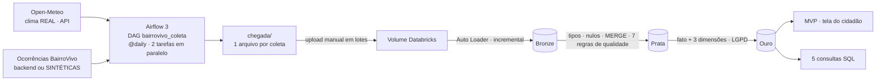

# BairroVivo · Pipeline de Dados (Big Data Architecture & Data Integration)

> FIAP · Global Solution 2026.2 · CitizenTech · Engenharia de Software 4º ano

**BairroVivo** é uma plataforma de zeladoria urbana colaborativa: moradores registram buracos, iluminação apagada, descarte irregular, calçadas danificadas e mobiliário quebrado, e a gestão acompanha tudo em um painel.
Este repositório é o **componente Dados do MVP**: coleta orquestrada no Airflow → camadas Bronze/Prata/Ouro no Databricks → tabela que o MVP consome.

## Integrantes

| Nome completo | RM |
|---|---|
| _preencher_ | _preencher_ |
| _preencher_ | _preencher_ |
| _preencher_ | _preencher_ |
| _preencher_ | _preencher_ |
| _preencher_ | _preencher_ |

## Arquitetura



O Databricks Free Edition não se conecta ao Airflow: por isso os arquivos da pasta `chegada/` sobem ao Volume **pela interface, em lotes**.

## Estrutura

```
dags/                 DAG do Airflow (bairrovivo_coleta.py) + biblioteca bairrovivo/ (coleta, gerador sintético)
databricks/           notebooks: 00_setup, 01_bronze, 02_prata, 03_ouro (.py) e 04_consultas (.sql)
amostras/             um pouco de cada fonte (clima real + ocorrências)
chegada/              pasta de pouso do DAG (os .json gerados NÃO vão para o GitHub)
docs/                 arquitetura, contrato de dados, modelo do relatório, checklist de entrega
scripts/              set_variables.sh · gerar_lotes_locais.py (plano B sem Airflow)
tests/                pytest do gerador · teste local em Spark · API falsa para teste offline
docker-compose.override.yml   complemento ao compose oficial do Airflow
```

MongoDB não foi usado: é opcional na disciplina e não vale ponto extra.

## Dados: o que é real e o que é sintético

| Fonte | Origem | Natureza | Frequência |
|---|---|---|---|
| Clima horário (temperatura, precipitação) | [Open-Meteo](https://open-meteo.com), API pública sem chave | **REAL** | diária (DAG) |
| Ocorrências de zeladoria | backend do BairroVivo (`bairrovivo_api_url`) **ou** gerador `dags/bairrovivo/gerador.py` | **SINTÉTICA** quando vem do gerador (coluna `origem = 'sintetico'`) | diária (DAG) |

* As ocorrências sintéticas são geradas por regras documentadas em `gerador.py` (determinístico, `seed` fixa). ~9% saem "sujas" de propósito e ~3% duplicadas, para a Prata ter o que barrar.
* **O gerador cria mais relatos de buraco em dias de chuva forte.** Isso faz a consulta Q4 (impacto) mostrar algo, mas é uma regra do gerador, **não é evidência real** de que chuva causa buracos naquele bairro. Diga isso no relatório.
* O bairro-piloto é um lugar **real** (coordenadas reais, para o Open-Meteo responder); só os relatos dos moradores são fictícios. Não há dado pessoal real no repositório.
* O Open-Meteo pede atribuição ("Weather data by Open-Meteo.com") e limita o plano gratuito a uso não comercial. Confira a licença atual no site antes de citar no relatório.

## Passo a passo para configurar

### 0. Pré-requisitos
* Conta no GitHub e Git instalado.
* **Docker Desktop** (Windows/macOS) ou Docker + Compose (Linux), com ~4 GB de RAM livres. O Airflow **não roda direto no Windows**: use Docker ou WSL2.
* Conta gratuita no **Databricks Free Edition**.
* (Opcional) Python 3.10+ para rodar os testes.

### 1. Criar o repositório público
1. No GitHub, crie o repositório **público** `bairrovivo-dados` (sem README, o daqui já existe).
2. Na pasta deste projeto:
   ```bash
   git init && git add . && git commit -m "Pipeline de dados do BairroVivo"
   git branch -M main
   git remote add origin https://github.com/SEU-USUARIO/bairrovivo-dados.git
   git push -u origin main
   ```
3. Preencha a tabela de integrantes (nome completo e RM de **todos**: falta de um tira 0,5 ponto).

### 2. Escolher o bairro-piloto
O padrão é a região da Av. Paulista (Bela Vista, São Paulo). Para trocar:
1. Pegue latitude/longitude do centro do bairro (clique direito no Google Maps).
2. Ajuste `LAT_PADRAO`, `LON_PADRAO` e `NOME_BAIRRO` em `dags/bairrovivo/config.py` (ou use só as Variables do passo 5).
3. Ajuste `LAT0`, `LON0` no começo de `databricks/02_prata.py` (a regra Q2 valida a coordenada contra essa caixa).

### 3. (Opcional) Testar sem nada instalado além de Python
```bash
pip install -r requirements.txt
pytest -q tests            # 7 testes do gerador
```

### 4. Subir o Airflow 3 com Docker
Dentro da pasta do projeto:
```bash
curl -LfO "https://airflow.apache.org/docs/apache-airflow/stable/docker-compose.yaml"
cp .env.example .env            # Windows PowerShell: Copy-Item .env.example .env
mkdir -p logs plugins config    # PowerShell: mkdir logs,plugins,config
docker compose up airflow-init
docker compose up -d
```
* O `docker-compose.override.yml` deste repositório é lido automaticamente: ele monta a pasta `./chegada` dentro dos containers.
* Abra http://localhost:8080. Usuário e senha padrão do compose oficial: `airflow` / `airflow`.
* Se o compose oficial mudar os nomes dos serviços e der erro no override, ajuste a lista `services:` do override para os nomes que o `docker compose config --services` mostrar.
* Sem Docker (Linux/macOS/WSL2): `pip install apache-airflow`, depois `export AIRFLOW_HOME=$PWD/.airflow AIRFLOW__CORE__DAGS_FOLDER=$PWD/dags AIRFLOW__CORE__LOAD_EXAMPLES=False` e `airflow standalone`. O DAG foi testado com `airflow dags test` no Airflow 3.4; o `standalone` e o Docker você valida na sua máquina.

### 5. Criar as Variables (requisito 03: chaves fora do código)
```bash
bash scripts/set_variables.sh      # Windows: rode no Git Bash ou WSL
```
Ou, na interface: **Admin → Variables → +**.

| Variable | Para quê | Valor padrão |
|---|---|---|
| `bairrovivo_lat`, `bairrovivo_lon` | centro do bairro-piloto | Bela Vista (SP) |
| `bairrovivo_api_url` | URL do export do backend. `mock` ou vazio = usa dados sintéticos | `mock` |
| `bairrovivo_api_token` | token Bearer do backend (valor real **nunca** vai ao Git) | `nao-definido` |
| `bairrovivo_webhook_url` | webhook (Discord/Slack) opcional para a notificação | vazio |

Tire um print da página de Variables (requisito 03).

### 6. Rodar o DAG e coletar os arquivos
1. Na lista de DAGs, ligue o `bairrovivo_coleta` (ele nasce pausado).
2. Como `catchup=True` e `start_date = 2026-10-20`, o Airflow cria uma execução por dia desde 20/10 até ontem, uma de cada vez. Em poucos minutos a pasta `chegada/` terá um `clima_AAAA-MM-DD.json` e um `ocorrencias_AAAA-MM-DD.json` por dia.
3. Se alguma tarefa falhar, ela tenta de novo 2 vezes. Veja o log pela interface.
4. **Prints do relatório (item 06):** visão **Graph** (mostra as 2 coletas em paralelo, a conferência e a notificação) e visão **Grid** com execuções verdes.
5. Deixe o Airflow ligado nos próximos dias: cada novo dia gera mais um arquivo.

Plano B se o Airflow não subir a tempo: `python scripts/gerar_lotes_locais.py --inicio 2026-10-20 --fim 2026-11-05` gera os mesmos arquivos. Mas os prints do Airflow são exigidos, então use o plano B só para destravar o Databricks enquanto resolve o Airflow.

### 7. Databricks Free Edition
**7.1 Importar os notebooks.** Workspace → Import → envie os arquivos de `databricks/` (formato fonte: `.py` e `.sql`). Alternativa: criar uma Git folder apontando para o seu repositório.

**7.2 Setup.** Rode `00_setup`. Ele cria o schema `workspace.gs`, o Volume `chegada` e as subpastas.

**7.3 Lote 1.** Em **Catalog → workspace → gs → chegada → clima → Upload to this volume**, envie os `clima_*.json` do **primeiro lote** (por exemplo 20 a 31/10). Faça o mesmo em `ocorrencias/`.
Rode `01_bronze` e anote as contagens (requisito 04 e 05).

**7.4 Lote 2.** Envie os arquivos seguintes (01/11 em diante) e rode o `01_bronze` de novo: só os arquivos novos entram. Rode uma **terceira vez sem enviar nada**: nada muda.
O enunciado pede lotes de "dias de coleta diferentes". Os nomes dos arquivos já têm datas diferentes; para garantir também dias reais diferentes, envie o lote 2 em outro dia, depois que o Airflow gerar novos arquivos.
Print: a tabela `controle_ingestao` (3 linhas por fonte: antes, depois do lote 2, depois da re-execução).

**7.5 Prata.** Rode `02_prata`. Print da saída com as contagens barradas por regra e das tabelas `prata_qualidade` e `prata_ocorrencias_rejeitadas`.

**7.6 Ouro.** Rode `03_ouro`. Print da verificação LGPD (sem e-mail, alias em hash, coordenada aproximada).

**7.7 Consultas.** Rode `04_consultas`. Para cada uma das 5: print do resultado + 1 ou 2 frases de interpretação com **os seus números**.

### 8. Entregar a Ouro ao MVP (requisito 08)
* A tabela que o MVP usa é **`workspace.gs.ouro_mvp_ocorrencias`**.
* O `03_ouro` também exporta `exportacao/ouro_mvp_ocorrencias.csv` no Volume. Quem faz o MVP baixa o CSV (Catalog → … → exportacao) e o front-end/backend lê esse arquivo. O esquema está em [`docs/contrato_dados.md`](docs/contrato_dados.md).
* Tire print da **tela do MVP** que exibe esses dados e cite no relatório qual coluna alimenta qual elemento da tela.

### 9. Relatório em PDF e entrega
1. Preencha [`docs/relatorio_template.md`](docs/relatorio_template.md), que já está na ordem exigida (9 itens), e exporte para PDF.
2. Confira o [`docs/checklist_entrega.md`](docs/checklist_entrega.md) (pontuação e penalidades).
3. Copie 2 arquivos de cada fonte para `amostras/` (comandos no `amostras/README.md`) e faça o commit final.
4. Gere o PDF com o link do repositório e **um** integrante envia no Teams da disciplina até **19/11 às 23h55**. Envie com folga. O repositório precisa estar **público** e no ar durante a correção.

## Solução de problemas

| Sintoma | Causa provável |
|---|---|
| `Permission denied` na pasta `chegada` (Linux) | `AIRFLOW_UID` do `.env` diferente do seu: use `id -u` |
| DAG não aparece | veja **Browse → DAG Import Errors**; confira se `dags/` está montada no compose |
| `conferir_chegada` falha | `coletar_clima` ou `coletar_ocorrencias` falhou; abra o log da tarefa |
| Clima de hoje vazio/nulo | a API pode demorar a consolidar os dados mais recentes; as linhas nulas são barradas pela regra Q6/Q7 (é esperado) |
| Auto Loader não acha arquivos | os arquivos precisam estar em `.../chegada/clima` e `.../chegada/ocorrencias` (subpastas), não na raiz |
| Contagem da Bronze dobrou | o checkpoint em `_controle/` foi apagado: apague também as tabelas `bronze_*` e recomece |

## Limitações
* Ocorrências sintéticas: os indicadores demonstram o pipeline, não a realidade de um bairro.
* Auto Loader e MERGE Delta só rodam no Databricks. O que dá para testar fora dele (Prata, Ouro e as 5 consultas, com MERGE emulado) está em `tests/rodar_local_spark.py`.
* A Prata lê a Bronze inteira a cada execução (a base é pequena; o MERGE garante a idempotência).
