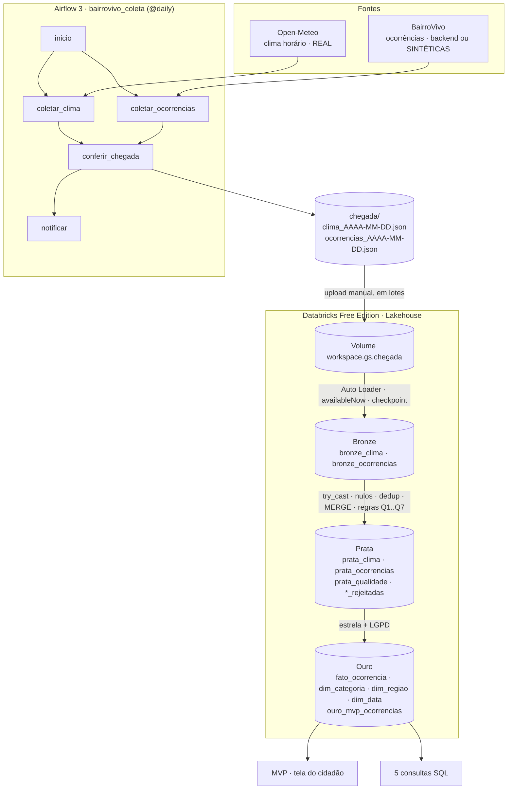

# Arquitetura e decisões

## Fluxo de dados (da fonte ao MVP)

## Decisões

| Decisão | Motivo |
|---|---|
| Arquivo por coleta, com a data no nome | A coleta é idempotente (rodar o mesmo dia sobrescreve o mesmo arquivo) e o Auto Loader enxerga arquivos novos. |
| Lógica em `dags/bairrovivo/` e DAG fino | A coleta é testável em Python puro, sem Airflow. |
| Bronze guarda tudo como veio (texto) + `arquivo_origem` + `carregado_em` | Linhagem e reprocessamento; os tipos são responsabilidade da Prata. |
| `try_cast` / `try_to_timestamp` na Prata | Valor inválido vira `NULL` e a regra de qualidade conta, em vez de derrubar o job. |
| Quarentena (`prata_*_rejeitadas`) | Nenhuma linha some em silêncio: dá para auditar o motivo. |
| MERGE por `id_ocorrencia` com `updated_at` mais novo | O mesmo id chega em vários arquivos (mudança de status): a Prata guarda o estado atual. |
| Ouro dimensional com `dim_data` enriquecida com o clima | É o ponto onde as duas fontes se encontram (consulta de impacto Q4). |
| LGPD: hash do alias, coordenada a 3 casas, sem e-mail nem texto livre | Minimização: a Ouro não precisa dessas informações para responder às perguntas do MVP. |
| Sem `.cache()` nos notebooks | O serverless do Databricks Free não suporta. |

## Modelo dimensional (Ouro)

| Tabela | Grão / papel | Colunas principais |
|---|---|---|
| `ouro_fato_ocorrencia` | 1 linha por ocorrência | `id_ocorrencia`, `categoria_sk`, `regiao_sk`, `data_criacao_sk`, `status`, `prioridade`, `lat_aprox`, `lon_aprox`, `grid_local`, `user_hash`, `horas_ate_primeira_analise`, `horas_ate_resolucao`, `resolvida`, `encerrada`, `origem` |
| `ouro_dim_categoria` | 1 por categoria | `categoria_sk`, `categoria`, `prioridade_padrao` |
| `ouro_dim_regiao` | 1 por região/setor | `regiao_sk`, `regiao` |
| `ouro_dim_data` | 1 por dia | `data_sk`, `data`, `ano`, `mes`, `dia`, `dia_semana`, `chuva_mm`, `temp_max_c`, `chuva_forte` |
| `ouro_mvp_ocorrencias` | desnormalizada para o MVP | `id_ocorrencia`, `categoria`, `regiao`, `status`, `prioridade`, `latitude`, `longitude`, `created_at`, `updated_at`, `horas_ate_primeira_analise`, `resolvida`, `origem` |

## Qualidade (Prata)

| Regra | Tabela | O que barra |
|---|---|---|
| Q1_chave_obrigatoria | ocorrências | `id_ocorrencia` nulo ou vazio |
| Q2_coordenada_no_bairro | ocorrências | lat/lon nulas ou fora da caixa do bairro-piloto |
| Q3_dominio_categoria_status | ocorrências | categoria ou status fora da lista válida |
| Q4_consistencia_temporal | ocorrências | `created_at` nulo, no futuro, ou `updated_at < created_at` |
| Q5_hora_valida | clima | `data_hora` não interpretável |
| Q6_precipitacao_valida | clima | precipitação nula ou negativa |
| Q7_temperatura_plausivel | clima | temperatura nula ou fora de -10 a 50 °C |
